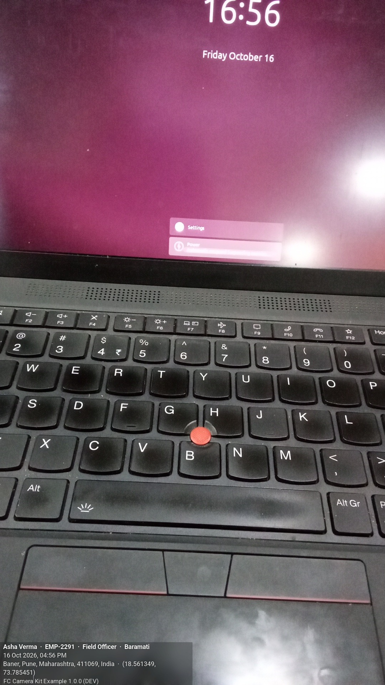
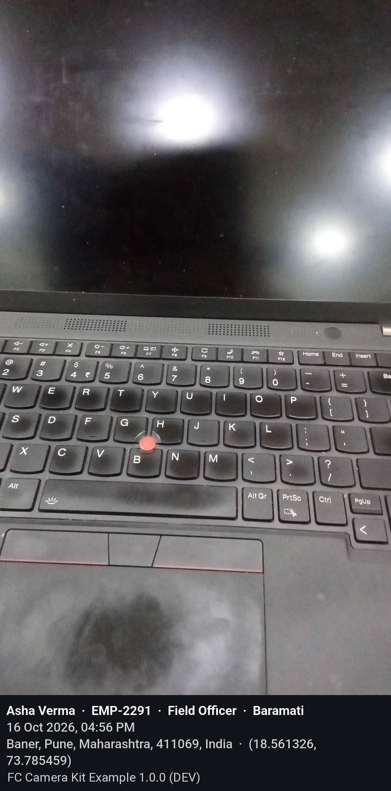
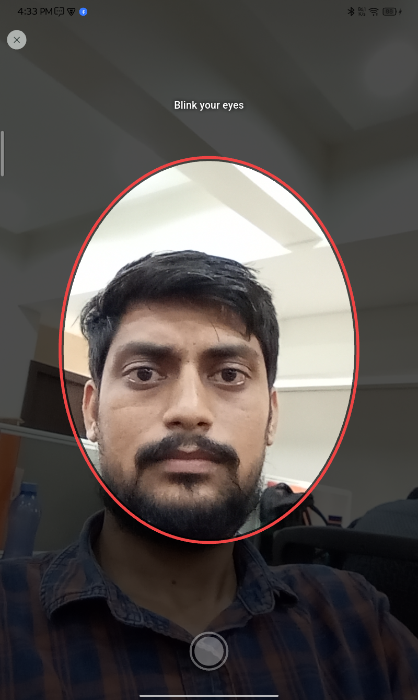
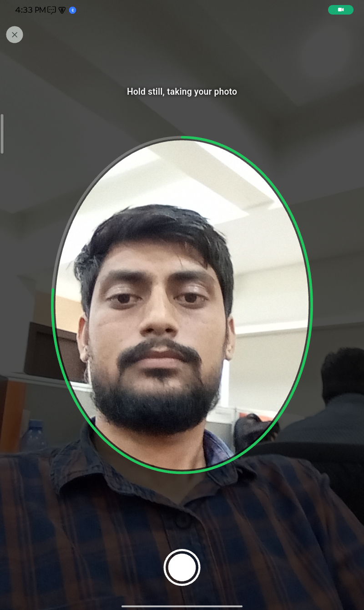

# fc_camera_kit

Capture a photo, stamp **who / when / where** onto it, embed the same facts in
its EXIF, squeeze it under a size budget, and hand it back as an `XFile`.

Built feature-first (clean architecture), driven by Cubits, **Android and iOS
only**.

| | |
|---|---|
| Version | 1.0.0 — see [CHANGELOG](CHANGELOG.md) |
| Platforms | Android 6.0 (API 23)+, iOS 15.5+ |
| Dart / Flutter | Dart 3.9, Flutter 3.35+ |
| State management | `flutter_bloc` (Cubit) |

---

## Table of contents

1. [What it does](#what-it-does)
2. [Features](#features)
3. [Install](#install)
4. [Platform setup](#platform-setup)
5. [Usage](#usage)
6. [What you get back](#what-you-get-back)
7. [Architecture](#architecture)
8. [Why `XFile` and not `File`](#why-xfile-and-not-file)
9. [Development](#development)

---

## What it does

A field worker takes a photo. That photo has to carry proof of who took it,
when, and where — in a form that survives a WhatsApp forward (burned into the
pixels) *and* in a form a backend can parse (EXIF). It also has to be small
enough to upload over a weak connection.

`fc_camera_kit` is that whole pipeline behind one call:

```
capture() ──▶ in-app camera ──▶ review (crop / rotate) ──▶ resolve context ──▶ stamp ──▶ compress ──▶ EXIF ──▶ XFile
                                                          (user, time, GPS)   (pixels)  (≤ maxMb)   (metadata)
```

### The camera

New photos are always taken on the kit's **own camera screen, inside the host
app**. The system camera app is never used: it sends the host to the
background, and Android kills background apps to free memory — on a
low-memory phone the user comes back to a restarted app and the photo is lost.

```
live preview ─► shutter ─► review ─┬─ Retake ─────────► live preview (shot deleted)
  flash auto / on / off            ├─ Crop & rotate ──► editor ─► Done / Cancel ─► review
  pinch zoom · lens switch         └─ Use photo ──────► stamp · compress · EXIF ─► XFile
```

| Screen | What the user can do |
|---|---|
| Live | Flash auto → on → off (kept across reopens), pinch zoom, switch front / back, shutter. Back lens at 1080p |
| Review | Pinch or double-tap to check sharpness. **Retake**, **Crop**, **Use photo**. A note says the stamp is added next |
| Crop & rotate | Drag corners or edges to resize, the middle to move. Shapes: Free, Original, Square. **Rotate** a quarter turn, **Reset**. Cancel / Done |

- **Back** steps out one level: editor → review → retake.
- Rejected and abandoned shots are deleted at once.
- The photo follows the screen's orientation, as the preview shows it. A
  portrait-locked app gets portrait photos; **Rotate** turns them.
- Crop and rotate are kept as numbers and applied once, when the photo is
  stamped: no extra encode, no quality lost.

### The stamp

Two placements, selected by parameter:

| Mode | What it looks like | Trade-off |
|---|---|---|
| `StampPlacement.overlay` | Translucent footer drawn **on top of** the photo, bottom-aligned | Original aspect ratio preserved; covers part of the image |
| `StampPlacement.extend` | Canvas grown **below** the photo, text on a solid strip | Nothing is hidden; aspect ratio changes |

Lines, each dropped when empty:

```
Asha Verma  ·  EMP-2291  ·  Field Officer  ·  Baramati   (name · id · role · branch)
16 Oct 2026, 04:56 PM
Baner, Pune, Maharashtra, 411069, India  ·  (18.561326, 73.785459)
Lenovo | TB328XU                                         (only with includeDeviceInStamp)
FC Camera Kit Example 1.0.0 (DEV)                        (production shows the app name alone)
```

| `StampPlacement.overlay` | `StampPlacement.extend` |
|:---:|:---:|
|  |  |
| Footer over the photo, aspect ratio kept | Strip below the photo, nothing hidden |

A fix from a mock-location app is not refused: the location line ends in
`(MOCKED)`, and EXIF and `metadata.location.isMocked` say so too.

### The EXIF

The same facts as the stamp, written into the file last (after compression),
so a backend can read them without OCR. Final format, with values from a
sample capture:

| Field | Group | Tag | Example | On stamp |
|---|---|---|---|:---:|
| App and build | IFD0 | `Software` | `FC Camera Kit Example 1.0.0 (DEV)` — production drops `(UAT)` / `(DEV)` | ✅ |
| User | IFD0 | `Artist` | `Asha Verma \| EMP-2291 \| Field Officer \| Baramati` — `name \| id \| role \| branch`, empty parts left out | ✅ |
| Capture time | Exif | `DateTimeOriginal` | `2026:10:15 18:33:57` — the shutter press | ✅ |
| Digitized / modified | Exif / IFD0 | `DateTimeDigitized` / `DateTime` | `2026:10:15 18:33:57` — same moment | — |
| Milliseconds | Exif | `SubSecTime` / `SubSecTimeOriginal` / `SubSecTimeDigitized` | `798` | — |
| Time zone | Exif | `OffsetTime` / `OffsetTimeOriginal` / `OffsetTimeDigitized` | `+05:30` | — |
| Address | IFD0 | `ImageDescription` | `Baner, Pune, Maharashtra, 411069, India` — `(MOCKED)` appended for a mock fix | ✅ |
| Latitude | GPS | `GPSLatitude` + `GPSLatitudeRef` | `18, 33, 40.8834` + `N` (stored as degrees, minutes, seconds) | ✅ |
| Longitude | GPS | `GPSLongitude` + `GPSLongitudeRef` | `73, 47, 7.62576` + `E` | ✅ |
| Mock location | GPS | `GPSProcessingMethod` | `MOCKED` — absent for a real fix | ✅ |
| GPS accuracy | GPS | `GPSHPositioningError` | `13.59` (metres) | — |
| GPS fix time | GPS | `GPSDateStamp` + `GPSTimeStamp` | `2026:10:15` + `13, 3, 34` (UTC) | — |
| GPS datum / version | GPS | `GPSMapDatum` / `GPSVersionID` | `WGS-84` / `2.3.0.0` | — |
| Device | IFD0 | `Make` / `Model` | `Lenovo` / `TB328XU` | with `includeDeviceInStamp` |
| Orientation | IFD0 | `Orientation` | `1` — rotation is already in the pixels | — |
| Photo id | Exif | `ImageUniqueID` | `d7c3d479166c4ffba71888f03c7495df` — UUID v4, 32 hex digits, also `metadata.imageId` | — |
| Written by | Exif | `UserComment` | `fc_camera_kit` (behind the `ASCII` charset header) | — |

`ImageWidth` / `ImageHeight` (stamp strip included) and `LightSource` (`0`)
come from the encoder, not the kit. Two sample captures, with every tag as
stored, are in [doc/photo_exif_details.xlsx](doc/photo_exif_details.xlsx).

Text that is not ASCII (e.g. a Devanagari address) is left out of EXIF
rather than written as `?`; the stamp still shows it. Altitude is not
written: the platforms report height above the ellipsoid, EXIF means sea
level.

### Face scan — `scanFace()`

A selfie on the front camera with an offline liveness check (ML Kit, no
network). The user fits their face in the oval and blinks; the ring turns
green and the photo is taken by itself after `autoCaptureAfter` (1 s by
default), or on the shutter.

| Waiting for a blink | Blink seen, capturing |
|:---:|:---:|
|  |  |

- Hints guide the user: one face only, position in the oval, move closer or
  back, look straight, too dark, blink, hold still.
- `blinks` sets how many blinks are needed; `mirrorSelfie` saves the photo as
  the user saw it in the preview.
- EXIF is written as for `capture()`; the stamp is off by default
  (`stamp: true` to turn it on), since an identity selfie is usually kept
  clean.

### Document scan — `scan()`

Scans paper documents (Aadhaar, PAN, forms, receipts) with the platform's own
scanner: ML Kit Document Scanner on Android, VisionKit on iOS, through
`cunning_document_scanner`. The scanner screen is the platform's, so it looks
native on each OS.

```
scan() ──▶ platform scanner ──▶ edge detection · auto / manual capture ──▶ crop · rotate · filters ──▶ compress ──▶ EXIF ──▶ pages
```

| Option | Default | What it does |
|---|---|---|
| `maxPages` | `1` | Pages per scan; more than 1 gives a multi-page document |
| `source` | `FcScanSource.camera` | `camera`, `gallery` or `cameraAndGallery` |
| `enhancement` | `FcScanEnhancement.full` | `basic` (crop, rotate), `filters` (grayscale, B&W, colour), `full` (adds shadow and stain removal on Android) |
| `embedMetadata` | `true` | Writes the same EXIF as `capture()` into each page |
| `stamp` | `false` | Burns the who / when / where stamp onto each page; documents are kept clean by default |
| `maxMb` | from `init()` | Size limit per page |

Set the defaults once with `init(scan: FcScanOptions(...))` and override any
of them per call. The result is an `FcScanResult` with one `FcScannedPage` per
page, in scan order: the `XFile`, its size, width, height and metadata.
Design notes, including the live in-app scanner that is not built, are in
[`lib/src/features/scanner/README.md`](lib/src/features/scanner/README.md).

---

## Features

| Call | Use for | Status |
|---|---|---|
| `capture()` | A photo from the in-app camera or the gallery, reviewed, stamped, compressed, EXIF written | ✅ |
| `scan()` | A document: ML Kit Document Scanner (Android) / VisionKit (iOS), edge detection, crop, filters | ✅ — live in-app scanner designed, not built ([design](lib/src/features/scanner/README.md)) |
| `scanFace()` | A selfie with a blink check (ML Kit), offline | ✅ — online verification designed, not built ([design](lib/src/features/face_scan/README.md)) |

---

## Install

```yaml
dependencies:
  fc_camera_kit:
    git:
      url: https://github.com/<org>/fc_camera_kit.git
      ref: v1.0.0 # a tag or commit SHA — never a branch
```

```dart
import 'package:fc_camera_kit/fc_camera_kit.dart';
```

### Your app's constraints must fit these

| Package | Range the kit needs | Common clash |
|---|---|---|
| `geocoding` | `>=3.0.0 <5.0.0` | 5.x removed the top-level functions |
| `geolocator` | `>=13.0.2 <15.0.0` | |
| `camera` | `>=0.11.3 <0.13.0` | |
| `permission_handler` | `^12.0.1` | 13.x needs AGP 9 |
| `device_info_plus` | `^12.4.0` | |
| `image_picker` | `^1.2.2` | |
| `intl` | `^0.20.2` | |

Android builds need AGP 8.12.1+ and Gradle 8.13+ (from `device_info_plus` 12).

Everything under `lib/src/` is private. If something you need is not exported
from `fc_camera_kit.dart`, open an issue rather than reaching into `src/` — it
moves without a major version bump.

---

## Platform setup

`fc_camera_kit` is a **pure Dart package**, not a plugin — it has no Android or
iOS module of its own, so it cannot contribute manifest entries or Info.plist
keys to your app. Platform setup is therefore yours. The [`example/`](example/)
app has all of it applied; copy from there if in doubt.

### What you get for free, and what you must add

| | Android | iOS |
|---|---|---|
| Camera | **Automatic** — `camera_android_camerax` merges `CAMERA` in | You must add `NSCameraUsageDescription` |
| Location | **You must add** `ACCESS_FINE_LOCATION` + `ACCESS_COARSE_LOCATION` — `geolocator_android` declares nothing | You must add `NSLocationWhenInUseUsageDescription` |
| Photo picker | **You must add** `READ_MEDIA_IMAGES` | You must add `NSPhotoLibraryUsageDescription` |

Two reasons this is not the kit's job to do for you:

- **iOS makes it impossible.** Usage descriptions must live in the application
  bundle's `Info.plist`. No pod or package can inject them, so host-app setup is
  unavoidable on that platform regardless.
- **Location is optional here.** `requireLocation` defaults to `false`. A
  package that force-merged `ACCESS_FINE_LOCATION` would put a location
  permission — and its Play Store policy burden — on every consumer, including
  the ones who never stamp a location. `geolocator` itself declines to do this
  for the same reason.

The kit asks for camera and location itself, right before it needs them, with
its own explanation sheet. Don't request them first.

> **`RECORD_AUDIO`.** `camera_android_camerax` merges it in because the same
> plugin also records video. The kit never records audio, so if your app
> doesn't either, strip it — otherwise "Microphone" shows on your Play listing
> for no reason. The example manifest removes it with `tools:node="remove"`.
> Keep it if your app records video with sound.

### Android

`android/app/build.gradle.kts`

```kotlin
defaultConfig {
    minSdk = 23
}
```

`android/app/src/main/AndroidManifest.xml`

```xml
<uses-permission android:name="android.permission.CAMERA" />
<uses-permission android:name="android.permission.ACCESS_FINE_LOCATION" />
<uses-permission android:name="android.permission.ACCESS_COARSE_LOCATION" />

<!-- only if you let users pick an existing photo -->
<uses-permission android:name="android.permission.READ_MEDIA_IMAGES" />
<uses-permission android:name="android.permission.READ_EXTERNAL_STORAGE"
    android:maxSdkVersion="32" />

<!-- only if your app never records audio -->
<uses-permission android:name="android.permission.RECORD_AUDIO"
    tools:node="remove" />

<!-- keep camera-less tablets installable -->
<uses-feature android:name="android.hardware.camera" android:required="false" />
```

### iOS

`ios/Runner/Info.plist` — a missing usage description is a hard crash, not a
denied permission:

```xml
<key>NSCameraUsageDescription</key>
<string>Used to take the photos this app stamps and uploads.</string>
<key>NSPhotoLibraryUsageDescription</key>
<string>Used to pick an existing photo to stamp.</string>
<key>NSLocationWhenInUseUsageDescription</key>
<string>Used to record where a photo was taken.</string>
<key>NSMicrophoneUsageDescription</key>
<string>Required by the camera component; audio is never recorded.</string>
```

`ios/Podfile` — face detection needs iOS 15.5. `permission_handler` compiles
**every** permission in unless you opt out, and App Review rejects binaries
that link a permission with no matching usage description. Enable only these
three:

```ruby
platform :ios, '15.5'

post_install do |installer|
  installer.pods_project.targets.each do |target|
    flutter_additional_ios_build_settings(target)
    target.build_configurations.each do |config|
      config.build_settings['GCC_PREPROCESSOR_DEFINITIONS'] ||= [
        '$(inherited)',
        'PERMISSION_CAMERA=1',
        'PERMISSION_PHOTOS=1',
        'PERMISSION_LOCATION=1',
        # everything else explicitly 0 — see example/ios/Podfile
      ]
    end
  end
end
```

---

## Usage

### 1. Once, in `main()`, before `runApp`

```dart
await FcCameraKit.instance.init(
  maxMb: 2,                          // hard ceiling; fractions work, e.g. 0.5
  requireLocation: true,             // no GPS fix → no photo
  placement: StampPlacement.extend,  // or overlay (default)
  dateFormat: 'dd MMM yyyy, hh:mm a',
  includeDeviceInStamp: false,       // the device is always in EXIF
  app: FcApp(                        // required: EXIF Software and a stamp line
    name: 'FC Camera Kit Example',
    version: packageInfo.version,    // from package_info_plus
    environment: FcEnvironment.production, // or uat / development
  ),
);
```

Reading any setting before `init()` throws; `capture()` returns a
`ConfigurationFailure` instead.

### 2. Whenever the signed-in user is known or changes

```dart
FcCameraKit.instance.setUser(
  const FcUser(
    id: 'EMP-2291',
    name: 'Asha Verma',
    role: 'Field Officer', // optional
    branch: 'Baramati', // required; '' when the user has none
  ),
);
// on logout
FcCameraKit.instance.clearUser();
```

Blank fields are dropped, so an unset role or empty branch never leaves a stray
separator.

### 3. At the call site — one shared helper per app

```dart
final result = await FcCameraKit.instance.capture(
  context,
  source: FcCaptureSource.camera,   // omit to let the kit ask: camera or gallery
  placement: StampPlacement.extend, // per-call overrides of init()
);

result.when(
  success: (photo) => upload(photo.file),
  failure: (failure) {
    final message = switch (failure) {
      CancelledFailure() => null, // the user backed out: not an error
      LocationFailure() => 'Could not get your location. Turn on GPS.',
      PermissionFailure(:final permanentlyDenied) when permanentlyDenied =>
        'Allow camera and location in Settings.',
      PermissionFailure() => 'Camera and location access are needed.',
      _ => 'Could not capture the photo. Please try again.',
    };
    if (message != null) showError(message);
  },
);
```

`capture()` never throws; every outcome is in the result.

### 4. Use the file as it is

- It is already stamped, compressed and geotagged. **Don't compress or
  watermark it again** — that loses quality and strips the EXIF.
- It lives in the app's documents directory (`fc_camera_kit/`), safe across
  an upload retry or an offline queue. **The kit never deletes it**: delete it
  once it is uploaded.

---

## What you get back

```dart
final class FcCaptureResult {
  final XFile file;              // stamped, compressed, EXIF written
  final FcPhotoMetadata metadata; // exactly what was stamped and embedded,
                                  // imageId included: send it with the upload
  final int sizeBytes;
  final int width;
  final int height;
  final bool wasCompressed;       // false when the first encode already fit
  final int quality;              // JPEG quality it was encoded at
}
```

Failures are one sealed set, so a `switch` over them is exhaustive:

| Failure | Meaning |
|---|---|
| `CancelledFailure` | The user backed out. Treat as a no-op |
| `PermissionFailure` | Access denied; `permanentlyDenied` means only Settings can fix it |
| `LocationFailure` | No GPS fix in time, or location services off |
| `CameraFailure` | The camera failed to open or take the photo |
| `ImageProcessingFailure` | Stamping, cropping or encoding failed |
| `SizeLimitFailure` | Still over `maxMb` at the lowest quality and size |
| `StorageFailure` / `MetadataFailure` | Saving the file or writing EXIF failed |
| `ConfigurationFailure` | `init()` not called, or invalid settings |
| `UnknownFailure` | Anything else |

`scan()` and `scanFace()` work the same way: one call, an `FcResult`, never a
throw. Face scan's design notes are in
[`lib/src/features/face_scan/README.md`](lib/src/features/face_scan/README.md).

---

## Architecture

Feature-first clean architecture. `core/` holds what more than one feature
needs; features own their own layers.

```
lib/
├── fc_camera_kit.dart        # the only public surface
└── src/
    ├── core/
    │   ├── config/             # FcCameraKit singleton, FcUser, scan / face options
    │   ├── error/              # FcCameraException (thrown), FcCameraFailure (carried)
    │   ├── image/
    │   │   ├── compressor/     # quality, then size, against the byte budget
    │   │   ├── edit/           # crop and quarter turns: numbers until stamped
    │   │   ├── metadata/       # who / when / where, EXIF writer
    │   │   └── stamp/          # draws the stamp on a dart:ui canvas
    │   ├── navigation/         # push / close with exactly one result
    │   ├── permissions/        # one gateway per permission + facade
    │   ├── ui/                 # shared sheet and button chrome
    │   └── utils/              # FcResult and friends
    ├── features/
    │   ├── camera/             # live camera, in-app photo camera, review, crop editor
    │   ├── capture/            # capture(): source, permissions, processing screen
    │   ├── face_scan/          # scanFace(): framing, blink liveness
    │   ├── permissions/        # the permission gate and its sheets
    │   ├── scanner/            # scan(): platform document scanner
    │   └── stamping/           # stamp → compress → EXIF for a capture
    └── presentation/           # shared molecules (step list, finished view)
```

### Layer rules

| Layer | May import | May **not** import |
|---|---|---|
| `domain` | `core/error`, `core/utils`, Dart | Flutter, plugins, `data`, `presentation` |
| `data` | `domain`, `core`, plugins | `presentation` |
| `presentation` | `domain`, `core` | `data` |

`domain` staying Flutter-free is what makes the use cases unit-testable without
a widget binding. Repository *interfaces* live in `domain`, implementations in
`data` — so swapping `camera` for something else touches one file.

### Errors

Data sources **throw** `FcCameraException`. Repositories catch and return
`FcResult<T>` — a `typedef` over dartz's `Either<FcCameraFailure, T>`, with the
failure on the **left**. Cubits never `try`/`catch`; they `fold`.

`FcCameraFailure` is `sealed`, so a `switch` over it is exhaustive at compile
time — adding a failure type breaks every incomplete handler instead of silently
falling through.

> ⚠️ **`fold` takes the failure branch first.** That is dartz's convention, not
> ours. Where the ordering is easy to misread, use the success-first
> `when(success:, failure:)` extension instead.

Because `FcResult` is an `Either`, the full combinator set comes for free —
`map`, `flatMap`, `getOrElse` — plus `thenFlatMap` for chaining fallible async
steps without a stair of early returns.

`Either`, `Left` and `Right` are re-exported from `fc_camera_kit.dart`, so host
apps do **not** need to add dartz to their own `pubspec.yaml`.

### Why Cubit, and why so few `StatefulWidget`s

Cubit over Bloc: these flows are imperative commands (`capture()`, `stamp()`),
not a stream of domain events. An event class per command would be ceremony
with no payoff.

Rebuild discipline the package holds itself to:

- Pages are `StatelessWidget`; state lives in the Cubit, not in `setState`.
  `StatefulWidget`s are kept for gesture-local state only (a drag in progress,
  a zoom animation).
- `BlocBuilder` wraps the **smallest** subtree that actually changes, with
  `buildWhen` guarding it.
- One-shot effects (snackbars, pops, permission dialogs) go through
  `BlocListener`, never through a builder.
- States are `Equatable`, so an identical state emits no rebuild at all.
- Anything that does not depend on state is a `const` widget hoisted out of
  `build`.
- The kit's screens draw their own controls rather than themed Material chips,
  so a host app's theme can't make them unreadable on the dark camera surface.

---

## Why `XFile` and not `File`

Short version: **the pipeline returns an `XFile`, and converting it to a `File`
is one line.** The reverse — committing to `File` — is the choice you cannot
cheaply undo.

| | `dart:io` `File` | `package:cross_file` `XFile` |
|---|---|---|
| What it is | A handle to a path on a real filesystem | An abstraction over "some readable blob" |
| Platforms | VM only (Android, iOS, desktop). Importing `dart:io` marks the whole library web-incompatible | Everywhere, including web |
| API | Sync **and** async; `exists`, `delete`, `rename`, `copy`, `writeAsBytes`, `lengthSync` | Async only; `path`, `name`, `mimeType`, `length()`, `readAsBytes()`, `openRead()`, `saveTo()` |
| Ecosystem | What `Image.file` and `MultipartFile.fromFile` take | What `camera.takePicture()`, `ImagePicker.pickImage()` and `file_selector` **return** |

Why `XFile` wins here:

1. **No lossy round-trip.** The camera and the gallery picker already hand us
   an `XFile`.
2. **It is the ecosystem's currency.** Callers can pass the output straight
   into anything that accepts media from `image_picker` or `camera`.
3. **Conversion is trivial one way only.** `File(xfile.path)` works on every
   platform this package supports; the reverse from a web `XFile` doesn't.

On Android and iOS `xfile.path` is always a real path, and the pipeline writes
its output to an app-owned directory, so the file is safe to hold across an
upload retry.

---

## Development

```bash
flutter pub get
flutter analyze          # strict-casts / strict-inference, must be clean
flutter test

cd example && flutter run
```

House rules:

- `flutter analyze` clean is the merge bar.
- Every use case and every Cubit gets a test (`bloc_test` + `mocktail`).
- Comments stay short: one line per feature entry point, plus notes on
  non-obvious logic and bug fixes. Names explain the rest.
- Public API changes land with a `CHANGELOG.md` entry.

